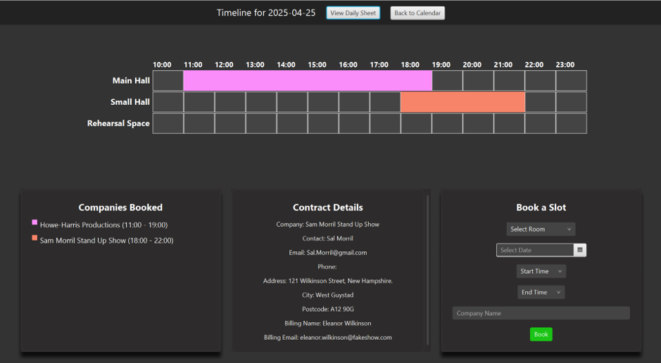
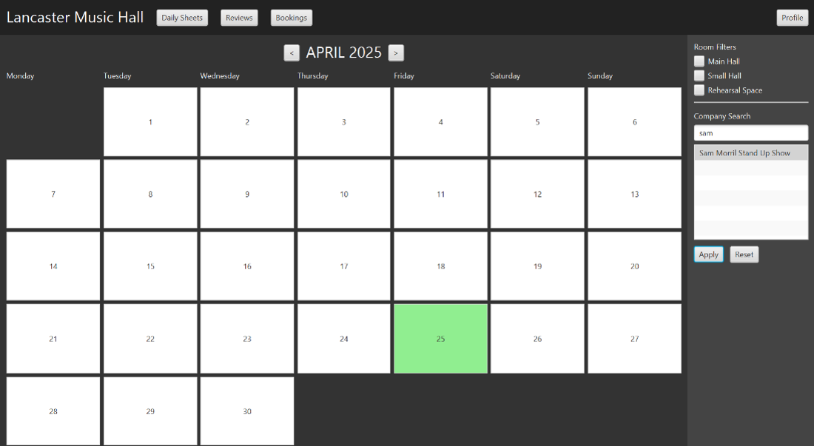
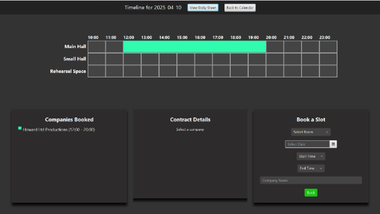

# Lancaster Music Hall: Venue Booking & Contract Management

A desktop application for the operations team of a multi-space music venue. Staff use it to see how every hall and room is booked across the month, drill into a day's timeline, create bookings without clashes, and pull up the contract and contact details behind each one.

Built in Java with JavaFX and a MySQL backend by a team of six as part of a three-team development group, each team owning a different part of the venue's systems (Operations, Box Office, Marketing). This repo is the Operations team's system plus the interfaces we exposed to the other two teams.



## Features

- **Monthly calendar** across the Main Hall, Small Hall, Rehearsal Space and meeting rooms, with room filters and company search that highlight matching days
- **Daily timeline** showing an hourly breakdown per space, so bookings can be made with the day's schedule in view and no conflicts
- **Booking creation** written straight to the database and reflected immediately in the calendar and timeline
- **Contract view** opened by clicking any booking, showing company, contact and billing details
- **Daily sheets** listing setup and room configuration for each booking that day
- **Login** backed by the user table in the database





## Architecture

```
            +--------------------+
            |   JavaFX GUI       |   CalendarGrid, Timeline, DailySheet, Contract views
            +---------+----------+
                      |
            +---------v----------+
            |   GuiController    |   navigation, filtering, booking logic
            +---------+----------+
                      |
     +----------------+-----------------+
     |                                  |
+----v-----+                  +---------v----------+
|  MySQL   |                  | Inter-team APIs    |
| bookings,|                  | BoxOfficeAPI       |  seating, schedules, show info
| contracts|                  | MarketingAPI       |  calendar gaps, group bookings
| rooms,   |                  | OperationsAPI      |
| clients  |                  +--------------------+
+----------+
```

The three API modules are Java interfaces plus data classes that define the contract between our system and the other teams'. Each team implemented against the agreed interface, so the systems could be developed in parallel and integrated at the end.

## Tech stack

Java, JavaFX (Scene Builder), Maven, MySQL, JDBC, Figma for UI design

## Repository structure

```
CodeBlooded/            JavaFX application (Maven project)
codeblooded-archive/    Earlier parallel version, kept for history
BoxOfficeAPI/           Interface and data classes for the Box Office team
MarketingAPI/           Interface and data classes for the Marketing team
OperationsAPI/          Operations team interface
docs/                   Screenshots
```

## My role

I led the team of six. That covered running weekly planning and a Kanban board, setting up and managing this repository, coordinating requirements and deadlines with the Box Office and Marketing teams, and running customer review meetings with the client.

On the technical side I co-built the Box Office interface, reviewed the Marketing interface, worked on the Figma designs, and contributed to the JavaFX GUI layout and functionality.

## What we learned

Parts of the GUI were first built independently in Swing and others in JavaFX, which caused integration problems late on. We consolidated everything onto JavaFX with Scene Builder before the deadline. Next time the framework and tooling get fixed in week one.

We also found gaps in requirements caused by unclear ownership between the three teams. A shared responsibility matrix agreed by all team leads up front would have caught these earlier.

## Known limitations

- The Reviews and Profile panels from the design are not wired up yet
- No packaged build, and it depended on the university's MySQL server, which isn't publicly accessible

## Team

Team 17 (CodeBlooded), IN2033 Team Project, City St George's, University of London, 2025

Ranveer Hothi (Team Lead), Mohamed Enkissa (Deputy Lead), Grace Ussher, Hamza Hawchar, Justin Barba, Lukman Ali
